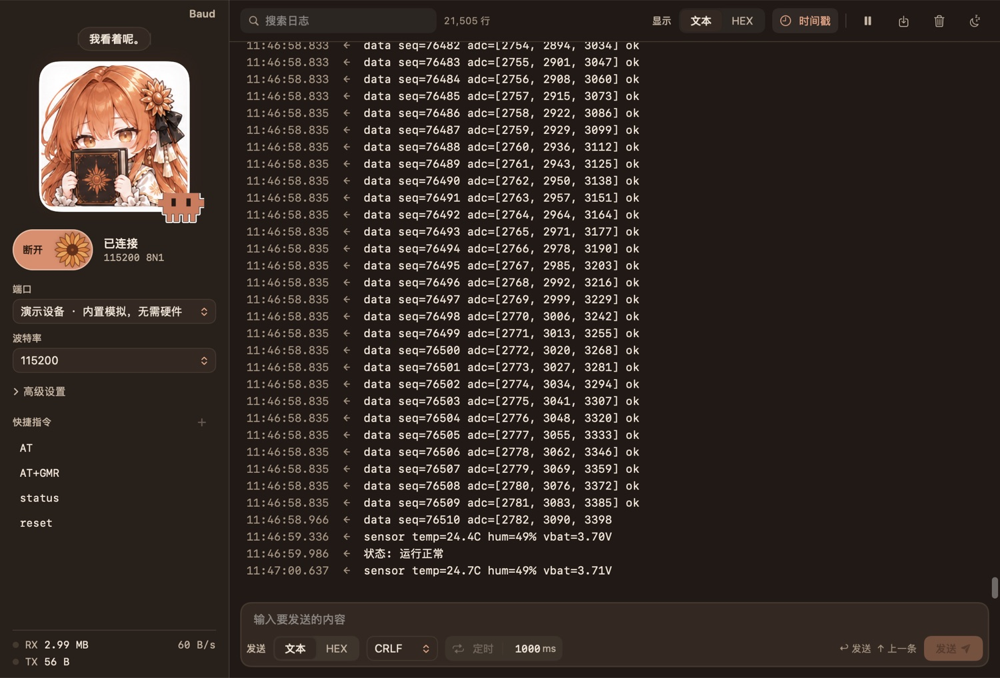
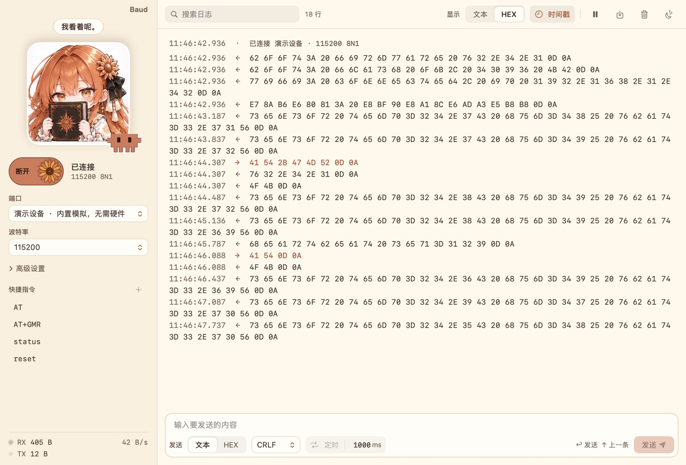
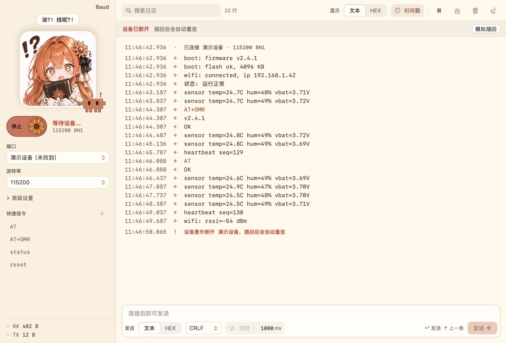

# Baud

一个会陪你看日志的串口助手，macOS 和 Windows 都能用。

名字取自波特率的单位 baud。


## 为什么做它

调板子离不开串口助手，一开就是一整天。常用的那几款功能都够，但界面大多停在很多年前：按钮挤成一片，字小，GBK 和 UTF-8 一不留神就乱码。换到 Mac 上，顺手的串口工具就更少了。

所以我想自己做一个，要求不多：

- 双击就能打开，不用装环境，断网也能用
- 功能够用就好，不追求大而全
- 好看，用起来顺手，动画要丝滑

做着做着，又冒出一个念头：既然每天要盯着它看那么久，能不能让它可爱一点？网友给 DeepSeek 画的鲸鱼娘让我印象很深，于是 Baud 的侧栏里也住进了一位看板娘：抱着书的 Claude 娘，旁边还蹲着 Claude Code 的小方块 Clawd。

她的表情会跟着串口状态变，台词都是 app 里的原话：

| 串口在干嘛 | 她说 |
|---|---|
| 还没连接 | 端口……还没连哦。 |
| 连上了 | 连上啦！ |
| 数据刷屏 | 好、好多数据！ |
| HEX 少输了半个字节 | 这个……不是成对的吧？ |
| 设备被拔掉 | 诶？！线呢？！ |
| 一直连不上 | 呜呜，还是连不上…… |
| 很久没有数据 | zzz…… |

连着戳她几下，她会害羞，戳多了还会生气。

不过可爱得有分寸，做的时候我们定了几条规矩：

- 日志区永远用等宽字体，干干净净，不铺花哨的背景
- 她只待在侧栏，不挡内容，也不弹窗打扰你
- 越常用的操作，动画越少。动画留给连接、发送、拔插这几个时刻
- 嫌她吵就按 ⇧⌘F（Windows 是 Ctrl+Shift+F）进专注模式，她会收起来，小方块留下陪你

## 它首先是个能干活的串口助手

<p>
  
  
</p>

- **串口参数**：波特率 9600 到 1500000，也可以自定义；数据位、停止位、校验位都能设，支持 RTS/CTS 和 XON/XOFF 流控。
- **收发**：文本和 HEX 都能发，也都能看。换行符可选，编码支持 UTF-8 和 GBK。按 ↑ 翻出上一条，常用指令可以存成快捷指令，还能按毫秒定时发送。
- **多条发送**：把一组指令排好，按顺序发，也可以循环发，拖一下就能调整顺序。
- **校验**：发送时自动在末尾加上校验，支持 ModbusCRC16、CCITT-CRC16、CRC32、ADD8、0-ADD8、XOR8 和 ADD16。
- **日志**：时间戳、搜索、暂停、清屏、保存。往上翻历史的时候，新数据不会把你拽回底部。
- **断线重连**：拔线不弹窗，只在顶上提示一句；插回去自动重连，设置都还在。
- **演示设备**：手边没有板子也能先试。它会回 AT 指令，也能模拟高速刷屏和拔线。
- **外观**：浅色和深色可以在 app 里单独选，不用为了它去改系统设置。

<p>
  
</p>

### 快捷键

| 操作 | macOS | Windows |
|---|---|---|
| 连接 / 断开 | ⌘K | Ctrl+K |
| 搜索日志 | ⌘F | Ctrl+F |
| 清屏 | ⌘L | Ctrl+L |
| 保存日志 | ⌘S | Ctrl+S |
| 暂停显示 | ⇧⌘P | Ctrl+Shift+P |
| 多条发送 | ⇧⌘M | Ctrl+Shift+M |
| 专注模式 | ⇧⌘F | Ctrl+Shift+F |

## 下载

到 [Releases](https://github.com/summer157/baud/releases) 下载最新版本。

- **macOS**：需要 macOS 14 或更新版本，Apple 芯片和 Intel 都支持。下载 `Baud-macOS.zip`，解压后把 Baud 拖进「应用程序」。
- **Windows**：下载 `Baud_*_x64-setup.exe` 安装，或者下载 `baud.exe` 直接运行。

两个版本都没有签名。Mac 第一次打开时，如果被拦下，到「系统设置 → 隐私与安全性」里点「仍要打开」。Windows 如果弹出 SmartScreen，点「更多信息 → 仍要运行」。

## 还不完美的地方

- Mac 版我用自己的 STM32 开发板实际收发过。Windows 版的真实串口、插拔和高分屏还在陆续测试，遇到问题欢迎提 [Issue](https://github.com/summer157/baud/issues)。
- Windows 上把窗口最小化后，定时发送和循环发送的间隔准不准，还没验证过。
- 波形图、协议解析、脚本、同时打开多个串口，这些是故意没做的。它们会让界面变复杂，以后真的需要再考虑。

## 从源码构建

Mac 版用 SwiftUI 和 AppKit 写，需要 Xcode 命令行工具和 Swift 5.10 或更新版本：

```bash
./build.sh
open Baud.app
```

Windows 版用 Tauri 2 写，需要 Rust、Node.js 和 pnpm，步骤见 [Windows 说明](windows/README.md)。

## 关于

Baud 是我和 Claude 一起做的，从界面构想、看板娘到串口层，都是一边聊一边改出来的。Codex（ChatGPT）也参与了开发，帮忙审查代码、跑测试，还完成了这次发布。

看板娘贴纸来自[《Claude娘二十四格日常反应表情包》](https://xn--pssy23gqgbz2d718b.com/works/claude202610270005.html)，版权归原作者。Baud 是个人作品，和 Anthropic 官方没有关系。
