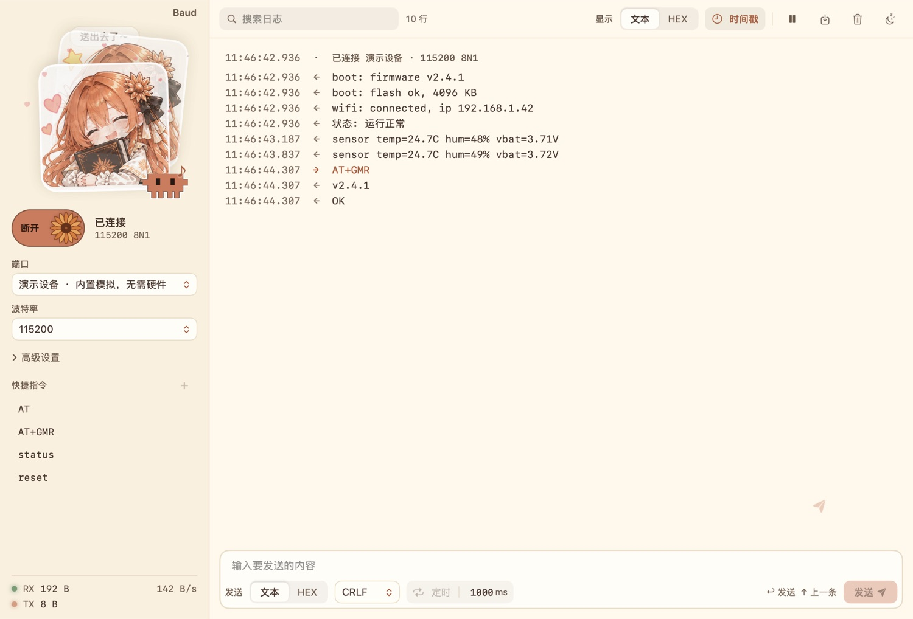

# Baud

一个会陪你看日志的串口助手。支持 macOS 和 Windows，提供演示设备，手边没有硬件也可以先试用。



## 下载

前往 [Releases](https://github.com/summer157/baud/releases) 下载对应平台的版本。

- **macOS**：需要 macOS 14 或更新版本。下载并解压 `Baud-macOS.zip`，将 Baud 拖入「应用程序」。应用未经 Apple 公证，首次打开时可能需要在「系统设置 → 隐私与安全性」中允许打开。
- **Windows**：下载 `Baud_*_x64-setup.exe` 安装，或下载 `baud.exe` 直接运行。程序没有代码签名，首次运行时 Windows 可能显示 SmartScreen 提示。

## 功能

- 串口收发，支持文本和 HEX、常用串口参数及自定义波特率
- 日志搜索、保存、时间戳，以及断线后自动重连
- 定时发送、多条发送和校验计算
- 演示设备、浅色与深色外观

## 从源码构建

macOS 需要 Xcode 命令行工具和 Swift 5.10 或更新版本：

```bash
./build.sh
open Baud.app
```

Windows 版使用 Tauri 2、Rust、Node.js 和 pnpm。开发与构建步骤见 [Windows 说明](windows/README.md)。

## 贴图来源

看板娘贴纸来源：[《Claude娘二十四格日常反应表情包》](https://xn--pssy23gqgbz2d718b.com/works/claude202610270005.html)。
